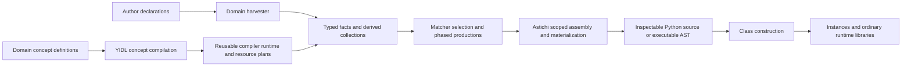

# Executable Architecture Through Facts and Scoped Code Composition: YIDL and Astichi

**First technical paper draft — intended audience: Onward! Papers.**

Prepared 2026-10-03; evidence revision 2026-10-23. This is an exploratory
implementation paper for an Onward! audience, not a submission-ready manuscript.
Authorship, affiliations, and human approval remain unset. Historical and current
checks are recorded separately. Claim identifiers
such as C3 point to [the evidence index](evidence-index.md); outstanding research
requirements appear in [the research gaps](research-gaps.md).

## Abstract

Framework policies often cross declarations, dependency analysis, storage and
accessors. We present an implemented architectural synthesis in which typed
facts select code resources, feature concepts extend named assembly phases,
and scoped AST composition connects the selected behavior to existing code.
YIDL supplies the fact and assembly model; Astichi supplies Python composition
holes, fallback bodies and explicit bindings. The concrete claim is that a
field policy can vary independently of its surrounding accessor recipe when
that recipe exposes an explicit extension boundary. In the central Lifecycle
case, a mutable lazy policy replaces an authored write-once setter body while
reusing the selected getter and factory dependency wiring. We trace declarations,
facts, selection, scoped insertion and generated Python, then validate behavior
and exact generated output with a qualified Python-backend/string-annotation
route. The unchanged runtime-annotation example still fails in the ambient
workspace. Dataclass and Undoable provide additional related object-model
applications and reported installed-package checkpoints. The contribution is
this inspectable synthesis and its demonstrated extension contract, not the
invention of generation, staging, hygiene or feature composition, nor evidence
of superior productivity, performance or unrelated-domain generality.

## 1. Problem: making framework relationships inspectable

Consider a field whose value is initialized on first access, whose factory
depends on another field, and whose setter may either reject replacement or
allow it. The implementation involves more than an accessor: the constructor
must establish an uninitialized state; factory arguments must be resolved;
inheritance must preserve compatible declarations; the setter must implement
the selected policy; and the emitted names must refer to the correct state.
Transactional fields add current and working views, enlistment, publication,
rollback, and hooks. These relationships can become spread across decorators,
descriptor tables, state objects, and runtime control flow.

The motivating practitioner reports that `pyrolyze.lifecycle` had become too
large and entangled for the agents then available to extend reliably. The
resulting exploration moved through lifecycle-specific generation, a
template-oriented IDL, decorator compilation, fact tables, matcher-selected
resources, and production assembly. Astichi emerged because composing code
safely was itself a substantial problem. The account in `MetaSquaredLog.md`
describes this as a five-week detour. It is evidence of the practitioner's
experience and rationale, not measured elapsed development effort, a comparison
against unaided engineers, or evidence that the approach was impossible before
LLMs. [C1]

The question for this paper is architectural: **can a framework expose its
variation and assembly relationships as explicit compiler data, without trying
to replace every algorithm with declarations?** Our exploratory answer is a
two-part system. YIDL records and derives domain facts and chooses resources;
Astichi composes the selected code while tracking names and scopes. The
resulting code is an inspectable artifact between the architecture and its
runtime behavior. [C2–C8]

Our bounded claim is that **fact-driven policy selection and scoped insertion
can separate a field's setter policy from its lazy-read implementation through
an explicit assembly contract**. Section 6 follows that contract end to end:
`Mutable` selects a contribution, an indexed property hole identifies its
recipient, and explicit outer bindings connect the replacement to the existing
setter state. The getter resource and dependency-argument machinery are reused.
This is an implemented synthesis of established techniques, with a concrete
change boundary rather than a claim of a new composition paradigm. Section 8
positions it against AHEAD's feature refinement model. [C13, C18]

## 2. System model and boundaries

YIDL is already a generic concept-driven compiler framework. Its core objects
describe schemas, facts, derivations, resources, and assembly; they are not
restricted to lifecycle field kinds. It has a standalone `.yidl` frontend backed
by Lark and programmatic data-definition and recorded-concept interfaces.
`yidl-lifecycle` supplies domain declarations and a Python class harvester on
top of those mechanisms. Beyond the early dataclass/computed-class fixtures,
separate `yidl-dataclass`
and `yidl_undoable` packages now exercise generated dataclass policies and
transactional undo/redo. Their accepted local functional/package checkpoints
extend the application evidence within related object models; they do not
establish unrelated-domain generality. [C2, C9, C23]



This diagram distinguishes data flow from timing. Concept compilation builds a
compiler for a domain. The generated compiler runtime subsequently specializes
author declarations. In the lifecycle application, specialization occurs when
the decorator runs; it can therefore be part of application import latency.
The final instance executes generated methods and runtime library calls rather
than interpreting the full concept model on every access. [C10]

The boundary is deliberate but incomplete as an ideal. Lifecycle meaning lives
primarily in the downstream feature layers and harvester; Astichi knows about
Python syntax and composition, not lifecycle transactions. YIDL still contains
earlier lifecycle-related capsules and validation examples, and the downstream
frontend contains a field-kind-to-record dispatch. Package extraction is
evidence of separation, not proof that every domain-specific remnant or every
central dispatch has disappeared. [C2, C9]

## 3. YIDL mechanisms and composition semantics

### 3.1 Schemas and facts

A property describes a typed semantic column, with a default and storage name.
A record groups properties into a fact shape. A family is an open union of
record variants, so a feature can extend an inherited family. Collections
describe fact tables with cardinality and optional identity, including composite
identities. The data-definition schema and the populated container are distinct
objects. Generated record classes are plain slotted Python containers. [C3]

Collection identity supplies a place to define conflict behavior. Explicit
builder writes use `RejectDuplicate`, `AddIfAbsent`, or `ReplaceExisting`.
`AddIfAbsent` retains the existing record; `ReplaceExisting` chooses the new
record. `RejectDuplicate` rejects a different record at an existing identity,
while allowing reinsertion of the same object. These are fact-write policies,
not a universal rule that the last feature overrides everything. [C3]

Computed collections are filtered views over a source collection, with support
for additional filters. They do not automatically imply a general incremental
dependency engine. In particular, compiler-side computed facts must not be
confused with a lifecycle `derived` cache field: the former is implemented,
while the latter is not exposed in the current lifecycle marker surface. [C3,
C12]

### 3.2 Resource selection and derivation

Resources can represent code or templates, imported values, and literals.
Selection is separated from declaration: a matcher examines input records and
chooses a resource. Resource-valued results can travel through productions into
later facts, rather than having to be consumed immediately. The system also
supports contribution matchers for assembly and operation matchers for compiler
passes. [C4, C5]

For the generic resource matcher, a rule's score is the number of equality
conditions multiplied by its weight. Matching rules are considered in
descending score order. A default supplies a result when no rule matches;
without a matching rule or default there is no result. The result records the
selected resource, rule, score, input records, and inspected values. The
implementation rejects potentially overlapping equal-score rules for this
matcher surface rather than treating textual order as the intended precedence.
Multiple input sequences are traversed as a Cartesian product. This is useful
for small compiler fact sets, but requires attention to scaling. [C4]

A data production derives records into a target collection using an explicit
write policy. The canonical `dds_matcher_productions.py` fixture filters input
fields, selects required or defaulted parameter resources, and records selected
resources in parameter components. Aggregate operations cover work that is
less naturally expressed as one record mapping. They receive a
`DDSOperationContext` with record queries and writes; declared ordering can
control input traversal. The transaction-key fixture uses an imperative `seen`
set and counter to derive ordered unique transaction keys. This is an
intentional combination of declarative boundaries and imperative algorithms,
not a claim that every compiler algorithm has become a rule. [C5]

### 3.3 Concept merge and inheritance

`concept Child extends base.Parent` composes compiler definitions into a shared
semantic model. Schema families can gain variants, computed views can gain
filters, and matcher rules can accumulate. Resources, contributions,
productions, edges, and assemblies become available through the compiled
concept's merged maps. Concept inheritance is distinct from Python inheritance
of classes decorated by a domain frontend. [C6]

Merge is constrained. For ordinary named maps, the compiler deduplicates an
identical inherited object reached through a diamond, rejects distinct
same-named inherited definitions, and rejects a local redefinition of an
inherited name. Matcher merge has specialized behavior: compatible input names
are combined, differing sources for the same input reject, conflicting defaults
reject, and distinct duplicate rule names reject. Production extensions are
also deduplicated through shared inherited identities. Consequently, composition
is neither arbitrary replacement nor a demonstrated commutative algebra over
all features. Exact closure order and extension contracts matter. [C6]

The historical import/merge plans describe gaps that have since acquired
implementations and tests. They explain the design trajectory; they are not
current feature inventories. Export metadata is likewise not evidence of a
complete privacy system, and concept containment is a proposal rather than the
implemented core composition operator. [C6, C14]

### 3.4 Phased assembly

YIDL uses “production” for two related roles: deriving data records and building
composable output. A composable production declares a root and applications of
contributions. Contributions associate a resource with a target, instance
identity/index, order, and identifier or external bindings. Target selectors
refer to build paths and/or code owners. The assembly runtime translates these
requests into Astichi resource and binding requests. [C7]

Named phases group applications in a composable production. A feature can extend
an extensible inherited phase or introduce a phase anchored `after` another
phase. The implementation orders roots and siblings by numeric `order`, using
declaration order for ties, and traverses anchored descendants after their
anchor. It detects missing anchors, self-anchors, cycles, and conflicting phase
metadata. The phases are flattened into ordered applications before assembly;
they are not a runtime transaction scheduler. [C7]

Phase context also has defined replacement behavior: an application-level
`from` overrides the phase source context, and an application-level `where`
replaces the phase predicate. Assuming predicates are always conjoined would
misread the current semantics. The parser tests make this distinction explicit.
[C7]

Named phases let the base specify an assembly skeleton while a feature adds
slots, parameters, properties, or commit bodies at declared boundaries. They
reduce one source of coupling: the base need not enumerate every future
feature's apply edge. They do not remove dependencies among features or prove
that every combination is valid.

## 4. Astichi: composing code with explicit names and scopes

Astichi compiles marker-bearing, syntactically valid Python source into
composables. Marker syntax belongs to the source DSL; it is not a runtime
`astichi.markers` library that an application executes. Builders register
resources, instantiate contributions, connect holes, and bind demands. Final
materialization consumes composition markers and produces Python source or a
caller-owned executable `ast.Module`. Python's `compile` still turns that AST
into executable code. [C8, C10]

Holes have structural roles: statement blocks, expressions, parameters, call
arguments, and clauses are not interchangeable textual substitutions. A
defaulted block hole has an authored fallback suite. If nothing is inserted at
that site, materialization selects the fallback. If contributions fill the
site, they replace the fallback suite. Demands inside a discarded fallback are
inactive. Additive contributions and whole-fallback replacement are thus
compatible: replacing a fallback does not imply a general arbitrary AST rewrite
facility. [C8]

Identifier demands and external bindings solve different problems. An identifier
demand chooses a Python name and its relationship to bindings; an external
binding supplies a value used during specialization. In lifecycle resources,
`astichi_ref(external=state_slot)` denotes a selected attribute path, while
getter/setter name demands supply declarations and references. Cross-scope
sharing uses import/export/pass markers or explicit builder wiring.
`outer_bind=True` requests the immediate outer binding. Keeping a spelling is
another explicit policy, not a general escape from name resolution. [C8]

Each root and inserted contribution has a composition scope in addition to
ordinary Python lexical scopes. Independently introduced same-spelled locals
are renamed apart when necessary, with corresponding references rewritten.
Unresolved identifier demands reject; duplicate final function parameter names
reject rather than being repaired by renaming a public signature. Explicit
sharing is necessary when two fragments are intended to refer to the same
local. These are composition contracts with tests, not a formal proof of hygiene
for every possible Python construct. [C8]

The assembler layer exposes inventory-based candidate selection by demand name,
build path, and code owner. A caller can require exactly one candidate and obtain
missing/ambiguous diagnostics. Provenance and round-trip facilities help inspect
generated source, but do not preserve hidden builder semantics after arbitrary
edits: source remains authoritative. [C8]

### 4.1 A small executable example

This complete example selects an inserted body over a fallback:

```python
import astichi

root = astichi.compile('''def choose_value():
    with astichi_hole(body) as astichi_fallback:
        return "fallback"
''')
builder = astichi.build()
builder.add.Root(root)
builder.add.Chosen(astichi.compile('return "generated"\n'))
builder.Root.body.add.Chosen()
tree = builder.build().to_executable_ast()
namespace = {}
exec(compile(tree, "<example>", "exec"), namespace)
assert namespace["choose_value"]() == "generated"
```

The inspected output is the ordinary function `choose_value` returning
`'generated'`. Leaving the hole unfilled selects the fallback according to the
reference contract. The filled example was executed during drafting without
writing generated files. It illustrates structural substitution; meaningful
binding and hygiene claims additionally rely on the canonical scope fixtures.
[C8, V1, V6]

### 4.2 Nested composition and declared connections

An Astichi `build()` returns a composable that can participate in another build.
The canonical three-stage trace recipe packages leaf fragments into a middle
component, reuses it twice, and supplies a shared binding at the outer level.
YIDL likewise allows a contribution source to be another production. Lifecycle's
`CoreModuleProduction` inserts `CoreClassProduction`, whose own contributions
fill slots, initialization, properties and transaction methods without a
source-text round trip. These examples demonstrate composition of compositions,
not an associativity law under arbitrary regrouping. [C7–C9]

YIDL contributions declare resources, target constraints and bindings; assembly
and Astichi inventory resolution establish the concrete connections. Missing or
ambiguous required candidates produce diagnostics. Intentional sharing remains
explicit and distinct from hygiene's collision handling. The central setter
case below shows both target selection and outer-scope references. [C7, C8]

The author reports that replacing earlier imperative binding steps with
declarative auto binding made YIDL easier for an LLM to generate. This is an
attributed practitioner observation. A general LLM-authoring benefit remains a
hypothesis, separate from the implemented connection mechanism. [C21]

## 5. Worked selection example: from a fact to a policy

The following complete program uses the generic DDS interface, independently
of lifecycle, to select a required or defaulted resource:

```python
from yidl.generation.data_def_sys import DataDefinitionSystem, from_literal

dds = DataDefinitionSystem()
name = dds.property("Name", str)
defaulted = dds.property("Defaulted", bool, default=False)
field = dds.record("Field", name, defaulted)
fields = dds.collection("Fields", field, cardinality=dds.many, identity=name)
required = from_literal("required")
optional = from_literal("defaulted")

matcher = dds.matcher("Parameter")
source = matcher.input("field", fields)
matcher.default(required)
matcher.rule(
    name="defaulted",
    when=(source.prop(defaulted).eq(True),),
    resource=optional,
)
runtime = matcher.runtime()
a = runtime.resolve(field.record(name="count", defaulted=False))
b = runtime.resolve(field.record(name="label", defaulted=True))
assert a.resource is required
assert b.resource is optional
```

This example was executed during drafting. Here resources are literal values to
keep selection visible. In the canonical parameter-production fixture they are
Astichi resources, and a production carries `match.resource()` into parameter
facts associated with an owner-scoped initialization port. Ordering then yields
`count` followed by `label`, while an `init=False` field is filtered out. The
fixture connects schema, selection, derivation, and ordered assembly data;
merely templating two functions would not express that intermediate relationship.
[C3–C5, V2, V6]

## 6. Lifecycle case study

### 6.1 Architectural before and after

The original lifecycle implementation already has abstractions. It includes
`LCKind` hierarchies, field specifications, helper parameter policies, getter
and setter tables, close hooks, transaction managers, and record snapshots.
Calling it simply “hard-coded” would obscure both its capabilities and the
actual change. Its central module coordinates kind semantics, decoration,
storage, injection, views, and runtime transactions through interconnected
Python machinery. [C1, C11]

The replacement relocates significant field variation into compiler inputs:

| Concern | Handwritten reference | YIDL lifecycle application |
| --- | --- | --- |
| Field meaning | Kind hierarchy and handler construction | Marker/harvester facts and schema variants |
| Policy selection | Kind and helper dispatch across tables | Matchers over field/default/dependency facts |
| Class construction | Handwritten decorator and state machinery | Phased class productions using reusable resources |
| Field execution | Generic records and selected handler tables | Generated properties and direct state-slot code |
| Transactions | Runtime transaction/state coordination | Generated participant methods plus ordinary manager library |
| Extension contract | Coordinated edits to runtime and tables | Family/matcher/phase contributions plus frontend updates where needed |

This is a redistribution of architectural responsibility, not the elimination
of imperative code. `lifecycle_core.yidl` defines the structural skeleton;
default-factory, managed, transient, owned, const/static, and local-store layers
extend it through the current inheritance chain. The final base assembles the
module. Feature resources still contain ordinary Python algorithms, and the
harvester and transaction manager remain handwritten support code. [C9, C11]

The harvester merges inherited lifecycle declarations, validates overrides and
factory signatures, and records class, field, and transaction-method facts.
Factory/default objects are passed into the generated class builder through
named keyword bindings. Derived default-factory facts make dependency arguments
and evaluation order available to assembly. The output defines a slotted state
class, facade classes, properties, and transaction participant methods. A main
facade owns the state and retains materialized secondary facades; state-to-facade
references are weak. Current and working facades are created on demand. Runtime
manager calls and user factories remain runtime costs. [C9–C11]

### 6.2 One complete extension: mutable lazy storage

The desired extension preserves first-read initialization but permits later
replacement. A factory captures provider values only when first read; subsequent
provider writes do not invalidate its result. Direct assignment before first
read bypasses the factory. All facades share this nontransactional value.
The default policy remains write-once. `lazy` is the preferred marker and
`static` its exact alias, retaining internal field kind `"static"`. [C13]

This complete executable example reduces the canonical parity-fields case to
two fields. Postponed string annotations are an explicit reproduction condition,
matching that fixture's existing `from __future__ import annotations`; they are
not a correction retroactively applied to the earlier failed example. [V6–V8]

```python
from __future__ import annotations
from yidl_lifecycle.lifecycle import lifecycle, lazy, static

assert static is lazy
calls: list[int] = []

def make_mutable_items(mutable_number: int) -> list[int]:
    calls.append(mutable_number)
    return [mutable_number]

@lifecycle
class Config:
    mutable_number: int = lazy(default=42, mutable=True)
    mutable_items: list[int] = lazy(
        default_factory=make_mutable_items, mutable=True
    )

item = Config()
assert calls == []
item.mutable_number = 12
assert item.mutable_items == [12] and calls == [12]
item.mutable_number = 13
assert item.mutable_items == [12]                 # cached, not invalidated
item.current.mutable_items = [14]
item.working.mutable_items = [15]
assert item.mutable_items == [15] and calls == [12]
other = Config()
other.mutable_items = [7]                        # assignment before read
assert other.mutable_items == [7] and calls == [12]
```

The harvester carries marker policy into field facts. The following projection
uses the actual full fixture's property values (its other fields account for
orders 90 and 100); it is not a dump of the reduced example's orders:

| Fact property | `mutable_number` | `mutable_items` |
| --- | --- | --- |
| `FieldKind` | `"static"` | `"static"` |
| `Mutable` | `True` | `True` |
| `FieldOrder` | `90` | `100` |
| `HasDefault` / `HasDefaultFactory` | `True` / `False` | `False` / `True` |
| `ValueSlotName` | `_y_mutable_number_value` | `_y_mutable_items_value` |
| Factory parameter names | `()` | `("mutable_number",)` |

`StaticFields` filters the field family by kind. Existing property matching
selects `StaticDefaultFieldProperty` or `StaticDefaultFactoryFieldProperty`;
existing factory-argument contributions wire the provider read. The additional
setter selection and target are these authored declarations in
`lifecycle_const_static.yidl` (an excerpt within the enclosing concept):

```yidl
resource MutableLazyAssignment = template $[
    astichi_pass(state, outer_bind=True).astichi_ref(external=state_slot)._ = astichi_pass(value, outer_bind=True)
]$

contribution MutableLazySetter = MutableLazyAssignment {
    index FieldOrder
    order FieldOrder
    target lazy_setter_body {
        build /ClassDef/StaticFieldProperty[FieldOrder]
    }
    external state_slot = ValueSlotName
}

matcher LazySetterContributions(field: StaticFields) -> contribution {
    rule mutable when Mutable == True -> MutableLazySetter
}

extend production CoreClassProduction {
    phase lazy_setters after properties_static
        from field: StaticFields
        where FieldOwner == ClassId {
        apply lazy_setters using LazySetterContributions
    }
}
```

The `properties_static` phase first inserts the indexed property. Its setter
contains an authored `lazy_setter_body` fallback that accepts a value only while
the slot is `VOID`, then raises on later writes. The subsequent phase fills
that hole only for mutable fields. `state_slot` binds the selected storage path;
`astichi_pass(..., outer_bind=True)` shares the enclosing setter's `state` and
`value`. Filling the hole discards the whole fallback suite and its inactive
demands. With no selected contribution, the fallback remains. No getter
replacement is selected. [C8, C13]

The resulting getter/setter pair below is copied from the canonical formatted
output, inside `Config_FacadeBase`; its surrounding generated builder supplies
`VOID`, state layout and the factory binding. It is an excerpt, not a standalone
class definition:

```python
@property
def mutable_items(self):
    state = self._y_state
    value = state._y_mutable_items_value
    if value is VOID:
        value = _Config_mutable_items_default_factory(
            mutable_number=self.mutable_number
        )
        state._y_mutable_items_value = value
    return value

@mutable_items.setter
def mutable_items(self, value):
    state = self._y_state
    state._y_mutable_items_value = value
```

The constructor initializes the backing slot to `VOID` unless supplied a value.
The getter still performs provider lookup and caching; only the setter loses
its write-once branch. The canonical fixture checks all three lazy forms,
constructor overrides, repeated assignments, call counts and facade sharing;
rollback also leaves a mutable lazy write intact. In this revision both existing
outputs passed their behavior assertions, fresh canonical decoration passed,
and in-memory regeneration exactly matched the raw and formatted outputs.
No golden was written. [V7, V8]

The extension's actual change boundary is inspectable in Lifecycle commit
`f8c7e49`. Authored implementation changes were confined to the marker and
normalization module, harvester, public lifecycle export module, core field
schema, and const/static resource layer. They added the boolean policy and
alias, propagated inherited facts, exposed setter holes in all three property
variants, and added the replacement resource/matcher/phase. The compiled base,
canonical goldens, focused marker tests and documentation also changed. YIDL
core, Astichi, the transaction manager and the getter algorithms did not change
in that feature commit. This establishes reuse through an explicit new hole;
it does not show an extension added without modifying its owning base recipe,
or measure future maintenance cost. [C13]

### 6.3 Compatibility is a contract to delimit

This is an improved replacement aimed at simpler composition, not a demonstrated
strict behavioral superset of the original framework. The current decorator
does not chain user `__init__` or `__post_init__`. There is no generic generated
lifecycle `close` protocol. Binding fields use plain nontransactional storage
and intrinsic Python references rather than the original transactional,
explicit-reference-count semantics. The package also has an alternate
explicit-refcount support library; its presence does not make that the default
generated binding behavior. [C12]

Lifecycle `derived` cache invalidation, managed `initial_working`, and managed
sidecar field state are not exposed by current markers. Some original tests
were ported or normalized, while other cases have explicit deferred/rejected
status. Copied test names and skip explanations can preserve old terminology or
stale feature status. For example, a skip reason says local-store fields are
unimplemented even though a current layer and canonical fixture implement
them. Test counts cannot establish all original semantics or justify importing
the stronger promises of the old design summary into this paper. [C12, D1–D3]

Resource cleanup remains part of Pyrolyze through binding/effect deactivation,
subscription and resource-specific retirement, and explicit application paths.
Rollback of generated field state does not replace all teardown. Intrinsic
references and `__del__` do not guarantee prompt external cleanup across cycles,
Python implementations, or shutdown. A support-code comment promising immediate
teardown is not sufficient evidence for such a guarantee. [C12, D4]

### 6.4 Integration boundary and snapshot limits

The October 3 Pyrolyze snapshot defaulted to a monolithic LCM context path using
the extracted Lifecycle library, with mirroring/manual publication still present.
Its integration plan separated holder replacement from later manager unification.
A bounded October 23 source check found that `runtime/context.py` now delegates
to `context_lifecycle`, which imports the decomposed `context_state_lcm` classes.
The old default-path description therefore cannot supply current migration status.
This paper did not audit current integration acceptance. [C15, D8]

The inspected shared-completion fixture records a useful boundary: generated
instances on the same manager/key could not complete independently. Nested commit
reduced depth, direct child commit published both participants, and child rollback
discarded both. That characterization does not establish savepoints, outer
atomicity or general failure containment. Application integration must delimit
those contracts separately from the setter policy studied here. [C15]

### 6.5 Additional related applications

`yidl-dataclass` now supplies a separate generated dataclass implementation:
ordinary fields use direct slots, while factories, conversion, validation,
constant and lazy policies select specialized methods. Its generation guide
identifies inheritable YIDL modules and emitted source inspection. The neutral
comparison resource is also consumed by Undoable at regeneration time; Undoable
adapts its field reads and equality prelude and embeds the generated resource,
without a Dataclass runtime dependency. This is a second concrete reuse boundary
beyond Lifecycle's setter hole. [C23]

Undoable generates default/current/working facades over an in-memory transaction
and undo/redo runtime, reusing Lifecycle markers and normalization. Its original
transaction checkpoint and later comparison extension have separate acceptance
records. The current READMEs and owning final reviews report accepted local
functional/package behavior and isolated installed-wheel checks, using original
Astichi 1.1.3 and YIDL 0.1.0 wheels (plus Lifecycle 0.1.0 for Undoable comparison).
Those recorded runs were inspected, not rerun for this paper. Acceptance does
not transfer their historical timings to corrected final bytes. Both packages
remain related object-model applications, not a test of arbitrary domains or
proof of improved human/AI productivity. [C23]

## 7. Evidence and evaluation

### 7.1 What was inspected and executed

The October 3 snapshot and its failures remain in the evidence index. The
October 23 revision inspected current sources and owning package checkpoints,
then ran only bounded in-memory examples and canonical assertions. No product
suite, dependency repair, golden writer or benchmark was run. [V0, V6–V9]

| Observation | October 23 result | Scope |
| --- | --- | --- |
| Complete Astichi and DDS examples | Passed, explicit Python backend | Structural fallback substitution and typed-record resource selection |
| Original `Config` with runtime annotations | Failed: unsupported external binding value type `type` | Same declaration remains unreproduced; no root cause assigned |
| Same declaration with postponed string annotations | Passed fresh decoration and behavior | Qualified source-checkout route, cache off |
| Canonical parity-fields case | Both artifact behavior checks, source-shape checks and fresh decoration passed | Existing fixture with string annotations |
| Fresh canonical source | Exact raw and formatted golden equality | In-memory generation only; no artifact rewrite |
| New section 6.2 complete example | Passed | Explicit Python backend and string annotations |

This closes the earlier absence of any freshly reproduced central case. It does
not close unrestricted annotation/backend compatibility or provide a clean
installed-release artifact. A separate release assessment reported a full YIDL
suite result of 299 passed and 2 skipped on CPython 3.12.12 with Python lowering;
that is YIDL evidence, not a Lifecycle suite result. Dataclass/Undoable package
results remain attributed to their owning records. Exact commands, source hashes,
historical failures and environment exclusions are centralized in the index.
[C16, C23, V6–V9]

Goldens expose generated structure; behavior assertions test the resulting
policy. Neither guarantees semantic preservation. A mistaken expectation can
be encoded in both, so domain-contract review remains necessary. [C16]

### 7.2 Three distinct performance questions

**Compiler-generation time** includes parsing YIDL definitions, resolving
concepts, and producing a reusable domain compiler/runtime. **Decorator or
class-generation time** includes harvesting declarations, deriving facts,
selecting and assembling resources, materializing AST, compiling/executing it,
and invoking the class builder. **Per-instance runtime** includes allocating
facade/state objects, initializing fields, resolving factories, accessing views,
and transaction/resource work. Moving policy to generation can reduce repeated
interpretation while imposing substantial startup cost. [C10, C17]

Existing performance records concern different workloads and checkpoints:
earlier source-emitting dataclass generation, LCM import/decorator profiling,
native AST handoff counters, and constructors using already generated classes.
The constructor comparison excludes generation and uses a loop-based dataclass
post-init against specialized factory code. The newer Dataclass records also
retain historical artifact provenance and explicitly leave corrected final
paths untimed. None supports a combined speedup or an application-wide ranking.
The evidence index retains the numbers, conditions and separate measurement
entry points. No timing was performed for this revision. [C17, C23]

A future measurement should pin artifacts and engine capabilities, separate
cold startup from warm reuse, alternate comparison order and retain repetitions.
Generation, class specialization and instance execution require separate
budgets; transaction, memory and cleanup workloads need equivalent behavioral
contracts. Such measurement could strengthen the paper, but is not needed to
establish the demonstrated setter composition. [C17]

## 8. Related work and the bounded synthesis claim

**Generative programming.** Czarnecki and Eisenecker describe system-family
models and automated selection/assembly of components. YIDL continues that
tradition by representing variation as facts and selected resources. Its
contribution cannot be the broad idea of generating specialized systems from
domain models. The present comparison concerns how compiler facts, named
production phases, and scoped Python composition interact. [Generative
Programming](https://gsd.uwaterloo.ca/publications/view/86.html),
[Components and Generative Programming](https://gsd.uwaterloo.ca/sites/default/files/esec99.pdf).

**Feature-oriented composition.** AHEAD is a close architectural antecedent.
Its model composes nested named artifact sets using artifact-specific refinement;
class refinements add or extend members, and design rules constrain legal
ordering. Its calculator GUI example refines initialization, layout and listener
methods together. Thus coordinated extension of several generator surfaces is
already established. [Scaling Step-Wise Refinement, §§2–6](https://www.cs.utexas.edu/~schwartz/ATS/fopdocs/AHEAD-Theory.pdf).

The following comparison identifies this implementation's contracts rather than
ranking expressiveness:

| Question | AHEAD account | YIDL/Astichi case demonstrated here |
| --- | --- | --- |
| What is composed? | Named artifacts and refinements in nested sets | Schemas, facts, matchers and phased production definitions; selected scoped resources |
| What selects the setter? | Feature composition supplies refinements | `Mutable` on each field selects an indexed setter contribution |
| How is replacement delimited? | Artifact-specific refinement, including method extension/override | An authored fallback suite is replaced at `lazy_setter_body` |
| What orders assembly? | Refinement order and design rules | Named phase anchors plus contribution order |
| What connects local code? | Artifact-specific composition tools | Identifier/external bindings and explicit outer-scope sharing |

AHEAD already separates design from implementation through models, and discusses
richer refinements informed by multiple artifacts. We therefore do not infer
that facts, policy choice or fine-grained composition are beyond its model.
Our contribution is the traced working combination of per-field facts,
phase-addressed insertion and scoped Python binding. The unchanged getter and
exact generated-output/behavior checks make that combination concrete. No AHEAD
port or comparative maintenance experiment was performed. [C13, C18]
[Scaling Step-Wise Refinement, §§7, 9](https://www.cs.utexas.edu/~schwartz/ATS/fopdocs/AHEAD-Theory.pdf).

**Language workbenches and model-driven engineering.** Fowler's workbench
account combines semantic models, languages, generation, and editing support;
Schmidt describes domain models and transformation machinery for managing
platform complexity. YIDL's compiler input is an executable semantic model in
this broad sense. It currently offers textual/programmatic authoring and
generated-code inspection, without demonstrating the integrated editor tooling
associated with a full workbench. [Language
Workbenches](https://martinfowler.com/articles/languageWorkbench.html),
[Model-Driven Engineering](https://www.dre.vanderbilt.edu/~schmidt/PDF/GEI.pdf).

**Staging and partial evaluation.** Jones, Gomard, and Sestoft explain
specializing a program given part of its input; Taha and Sheard's multi-stage
work makes staging explicit. YIDL separates domain compilation, declaration
specialization, and instance execution. It is reasonable to interpret the
architecture as staging known policy, but the current evidence does not show
that it is an automatic partial evaluator of the original lifecycle runtime,
nor that it provides MetaML's type-safety results. [Partial Evaluation and
Automatic Program Generation](https://studwww.itu.dk/people/sestoft/pebook/),
[author-maintained multi-stage publication list](https://www.cs.rice.edu/CS/PLT/Publications/MultiStage/).

**Hygienic macros and AST quotation.** Hygienic expansion addresses accidental
capture in generated syntax; Racket provides explicit syntax objects, scopes,
and phases. Astichi applies explicit composition scopes, demands, and structural
holes to Python snippets. Its contracts should be compared against that
literature, not presented as the invention of hygiene. We have not proved
equivalence to Scheme/Racket binding models or a typed quotation calculus.
[Hygienic Macro Expansion](https://doi.org/10.1145/319838.319859),
[Racket Syntax Model](https://docs.racket-lang.org/reference/syntax-model.html).

**Decorator and model compilers.** Python dataclasses already generate methods
from annotated fields. Pydantic separates collected model information from a
core schema consumed by its validation/serialization engine. These demonstrate
that declaration compilation and structured intermediate representations are
established techniques. YIDL's scope is a reusable vocabulary for building such
domain compilers; `yidl-lifecycle` is one application of it. No benchmark or
feature comparison here establishes superiority over either library.
[Python dataclasses](https://docs.python.org/3/library/dataclasses.html),
[Pydantic architecture](https://pydantic.dev/docs/validation/latest/internals/architecture/).

**Declarative mappings and transactions.** SQLAlchemy connects class declarations
to tables/mappers and coordinates object changes through a Session unit of work.
Flush and commit are distinct; rollback commonly expires persistent state, and
explicit nested transactions can use database savepoints. [Declarative
mapping](https://docs.sqlalchemy.org/en/20/orm/declarative_styles.html),
[Session basics](https://docs.sqlalchemy.org/en/20/orm/session_basics.html),
[Transactions and savepoints](https://docs.sqlalchemy.org/en/20/orm/session_transaction.html).

Lifecycle instead generates in-memory current/working field views and participant
methods that cooperate with an ordinary manager. Fields on one instance can
belong to separate transaction keys. Same-key nesting is counted; multi-key
completion is sequential and does not establish atomicity across groups. These
are application-specific representation and completion choices, not the origin
of unit-of-work transactions or restrictions on YIDL's generic compiler model.
No SQLAlchemy backend or parity experiment is demonstrated. [C11, C15, C22]

The supportable contribution is an exploratory architectural synthesis with a
verified extension contract. A comparative implementation could test stronger
claims about edit locality or authoring effort; neither is asserted here. [C18]

## 9. AI-assisted development and methods provenance

The architecture contribution and the development account answer different
questions. The first asks what the implementation makes explicit. The second
asks how assistance affected its construction. The practitioner account reports
significant AI involvement in model exploration, implementation, generated-code
inspection, testing, and revision, including discarded directions and human
disagreement with suggested abstractions. This is a retrospective account, not
a controlled causal study. No claim of better LLM understanding, faster
development, or reduced error rates has been measured here. [C1, C19]

During preparation of this draft, a Codex assistant selected and read local
implementation, reference, test, golden, and historical sources; retrieved
primary literature and official policies; ran the bounded checks listed above;
and drafted the manuscript and evidence documents. The checks used the existing
environment and in-memory generation/execution, without writing generated
artifacts or editing product code.
Source artifacts and primary publications, rather than AI output, are the
evidence for technical claims. This is also an AI-assisted evidence-selection
process, so human review must check omissions and interpretations.

Before submission, this methods account needs the actual development tool/model
inventory and dates, preserved session or commit evidence, examples of accepted
and rejected suggestions, test and review practices, and the human decisions
that established domain semantics. Those details are not inferred from package
metadata or invented here. Named human authors must have substantive
contributions and accept responsibility for every claim and artifact. [C19]

The historical policy/venue check on October 3 distinguished writing assistance
from substantial AI involvement in research/artifact construction and recorded
Onward!'s exploratory-implementation audience and 2026 format constraints. The
2026 deadline has passed. The evidence index retains retrieval limits and exact
sources; a future call and policy must be checked afresh before submission.
[ACM authorship policy](https://www.acm.org/publications/policies/new-acm-policy-on-authorship),
[Onward! Papers 2026 call](https://2026.splashcon.org/track/splash-2026-onward--papers). [C20]

## 10. Limitations and open directions

The implementation has Lifecycle and two additional related object-model
packages. Current Pyrolyze integration acceptance was not audited; its earlier
characterization records explicit completion boundaries. This evidence is insufficient to establish domain-independent usability. More explicit architecture can make
relationships inspectable while also adding indirection and a new language to
learn. Human comprehension and ease of LLM authoring are distinct questions;
the LLM-authoring benefit is retained as a hypothesis rather than an evaluation
commitment in this paper. [C9, C18, C19, C21]

Fact typing, identity policies, matcher diagnostics, and scoped assembly constrain
composition, but do not prove the domain model correct or generated programs
safe. Imperative operation bodies and runtime libraries can still introduce
hidden coupling. Same-manager/key completion is not participant isolation;
garbage collection is not a resource-retirement protocol; and the qualified
string-annotation route does not establish unrestricted generation compatibility. [C12, C15, V6–V9]

Cross-language output, compiler self-description and unrelated-domain examples
remain proposals. The inspected domain output is Python; Astichi's native Rust
implementation is not evidence of a Rust output backend. [C14]

## 11. Conclusions

YIDL and Astichi expose a workable architectural division: schemas and facts
describe a domain, matchers select policies and resources, derivations prepare
assembly data, concept extensions contribute feature behavior, and phased,
scoped composition produces inspectable Python. The lifecycle application makes
that division concrete. Mutable lazy storage shows a setter policy selected
and inserted without duplicating the lazy getter, while the broader package
demonstrates generated storage, facades, and transaction participation.

The evidence now includes fresh generation and exact output reproduction for
the qualified central case, alongside attributed package evidence from related
applications. A clean pinned artifact, broader annotation/backend qualification,
stronger comparative claims, unrelated-domain reuse and measured performance or
human/AI benefits remain separate evidence obligations.

## References

1. Krzysztof Czarnecki and Ulrich W. Eisenecker. *Generative Programming:
   Methods, Tools, and Applications*. Addison-Wesley, 2000. [Author laboratory
   record](https://gsd.uwaterloo.ca/publications/view/86.html).
2. Krzysztof Czarnecki and Ulrich W. Eisenecker. *Components and Generative
   Programming*. ESEC/FSE, 1999, pp. 2–19. [Author-hosted
   paper](https://gsd.uwaterloo.ca/sites/default/files/esec99.pdf).
3. Don Batory, Jacob Neal Sarvela, and Axel Rauschmayer. *Scaling Step-Wise
   Refinement*. IEEE Transactions on Software Engineering 30(6), 2004,
   pp. 355–371. [Author-hosted
   paper](https://www.cs.utexas.edu/~schwartz/ATS/fopdocs/AHEAD-Theory.pdf).
4. Martin Fowler. *Language Workbenches: The Killer-App for Domain Specific
   Languages?* 2005. [Author
   essay](https://martinfowler.com/articles/languageWorkbench.html).
5. Douglas C. Schmidt. *Model-Driven Engineering*. IEEE Computer 39(2), 2006,
   pp. 25–31. [Author-hosted paper](https://www.dre.vanderbilt.edu/~schmidt/PDF/GEI.pdf).
6. Neil D. Jones, Carsten K. Gomard, and Peter Sestoft. *Partial Evaluation
   and Automatic Program Generation*. Prentice Hall, 1993. [Author book
   site](https://studwww.itu.dk/people/sestoft/pebook/).
7. Walid Taha and Tim Sheard. *Multi-Stage Programming with Explicit
   Annotations*. PEPM, 1997. [Author-maintained publication
   list](https://www.cs.rice.edu/CS/PLT/Publications/MultiStage/).
8. Eugene Kohlbecker, Daniel P. Friedman, Matthias Felleisen, and Bruce Duba.
   *Hygienic Macro Expansion*. LFP, 1986, pp. 151–161.
   [Publisher record](https://doi.org/10.1145/319838.319859).
9. Racket project. *Syntax Model*. [Official
   reference](https://docs.racket-lang.org/reference/syntax-model.html).
10. Python project. *dataclasses — Data Classes*. [Official
    reference](https://docs.python.org/3/library/dataclasses.html).
11. Pydantic project. *Architecture*. [Official
    documentation](https://pydantic.dev/docs/validation/latest/internals/architecture/).
12. ACM. *Policy on Authorship*. Updated May 14, 2026. [Official
    policy](https://www.acm.org/publications/policies/new-acm-policy-on-authorship).
13. Onward! Papers 2026. *Call for Papers*. [Official
    call](https://2026.splashcon.org/track/splash-2026-onward--papers).
14. SQLAlchemy project. *Declarative Mapping Styles*, *Session Basics*, and
    *Transactions and Connection Management*. SQLAlchemy 2.0 documentation.
    [Declarative mappings](https://docs.sqlalchemy.org/en/20/orm/declarative_styles.html),
    [Session basics](https://docs.sqlalchemy.org/en/20/orm/session_basics.html),
    [Transactions](https://docs.sqlalchemy.org/en/20/orm/session_transaction.html).

Online sources checked 2026-10-03; SQLAlchemy sources checked 2026-10-04;
AHEAD comparison refreshed from the author-hosted paper on 2026-10-23.
This first-pass bibliography verifies
publication identities and the bounded comparisons above; it is not a complete
novelty review. Retrieval limits are recorded in the evidence index.
