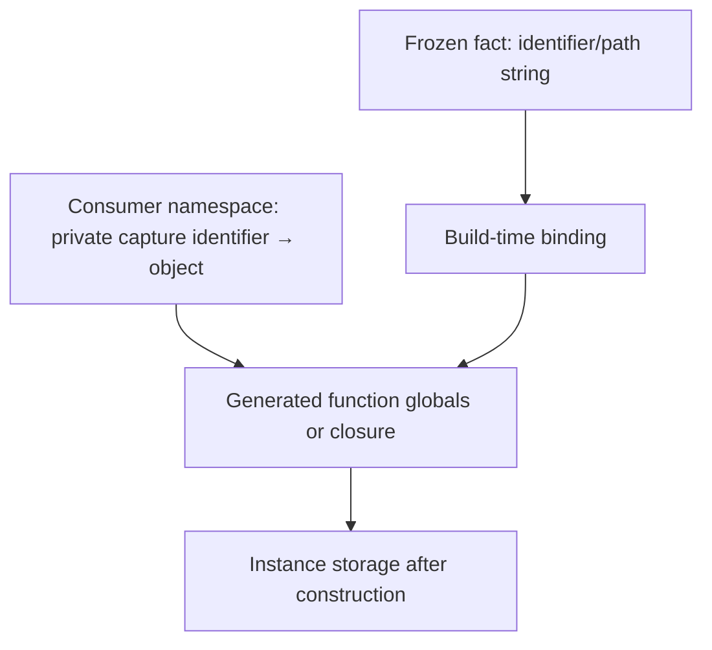

# Names, values and build state

| Need | Mechanism | Example |
| --- | --- | --- |
| Choose a Python identifier | `ident` / identifier demand | Parameter `x` |
| Choose an attribute path | `astichi_ref(external=slot)` and external path string | Direct `self.x` |
| Insert literal data | `external` / literal wrapper | Slot tuple `("x", "y")` |
| Read a containing lexical binding | `astichi_pass(..., outer_bind=True)` | Store reads constructor parameter |
| Prevent deliberate name hygiene | `keep`, `astichi_keep`, suffix keep | Public `self` / selected method name |
| Retain a live Python object | Fresh execution namespace or authored factory capture | Callback, opaque default, live type |

A spelling ending `__astichi_arg__` is an identifier demand. Putting that spelling
in an ordinary attribute does not make it an attribute-path demand. `keep` keeps
a spelling; it does not supply the value or fix an unresolved binding.

For an arbitrary object, install it under a deterministic private name in a fresh
namespace. Bind that **identifier string** into a template. Never turn its `repr`
into executable source and never call a factory during generation to guess a
literal. Two independent builds need independent capture namespaces, even when
they reuse one unbound template.

Frozen data, cached templates, mutable builder state, materialized AST and
completed classes have separate lifetimes. Do not mutate a returned cached
unbound composable expecting all clients to be isolated automatically. Use the
owning SDK's composition/binding operations and qualify copy/materialization
behavior for your backend. Native failure isolation, foreign handles and repeated
materialization are not broadly promised by this documentation.

## Execute the capture-isolation recipe

Run `example/documentation/captures.py` with the installed interpreter and Python
engine. It executes one generated AST in two fresh namespaces, checks hostile-repr
objects retain identity, and proves callbacks are called only at runtime.

{{source:example/documentation/captures.py|python}}
