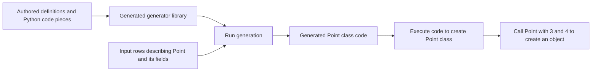

# How YIDL works

**Learning path · Step 1 of 4.** Start with this overview; no installation or
commands are needed on this page. Next comes [Generation stages](generation-pipeline.md).

YIDL helps you write a **Python code generator**: a program that builds other
Python classes and functions from structured input. Use it when several related
classes need different combinations of fields, methods or initialization steps,
and you want reusable code pieces plus explicit rules for combining them.

The first tutorial generates a plain `Point` class with slots `x` and `y` and a
constructor that stores its arguments directly. More elaborate generators can
select property accessors, default/factory calls and ordered method statements.
The [compatibility table](../reference/compatibility.md) bounds the demonstrated
language, Python and backend combinations; this is not a promise that every
Python construct can be inserted in every position.

## What you supply

Think of writing a generator as separating a Python recipe from its inputs:

| You supply | In the Point tutorial | Purpose |
| --- | --- | --- |
| The shape of the generator's inputs | A class row and field rows with names, owners and order | Describe what information the generator can read |
| Reusable Python code pieces | A class shell, constructor, parameter and assignment | Describe the output shapes you want |
| Selection and placement rules | Select a field's parameter/store and place it in the constructor | Decide which pieces to use and where |
| Python code that supplies input and runs generation | `generate.py` | Supply the particular class/field rows and execute the result |

The `.yidl` file holds the first three parts. The Python driver supplies the
fourth. A project using YIDL this way is called a **consumer**: it is an
application of the generator compiler. Lifecycle, Dataclass and Undoable are
larger consumers; the Point tutorial needs none of those packages.

## Two generated products, then user objects

YIDL first compiles your `.yidl` definitions into a **generator library**. In the
tutorial this is `runtime.py`. It defines Python classes for input rows, a place
to collect those rows, and functions that assemble the requested application
code. Importing this library does not by itself create Point instances.

You then supply rows describing the particular class to generate. Running the
library's assembly function combines the selected code pieces into Python code
for that class. The tutorial saves a readable copy as `model.py` and executes
the generated Python tree to obtain the `Point` class. Finally, ordinary
application code calls `Point(3, 4)` to create an object.

| Item | What it describes | When it exists |
| --- | --- | --- |
| `classes.yidl` | How to generate this family of classes | Generator authoring |
| `runtime.py` | Row types and assembly functions for that generator | Generator preparation |
| A field row containing `field_name="x"` | A name the generator should put in code | One generation's input |
| `model.py` / the generated Python tree | Code defining the selected Point class | Generation output |
| `Point` | The executable Python class | After executing generated code |
| `Point(3, 4)` | An ordinary instance whose x and y values are 3 and 4 | Application execution |

In particular, a **fact** is an input value describing what to generate. The fact
that a field is named `x` is different from the value `3` stored in an object's
`x` slot. Generating a class and constructing an instance are separate actions.

## Names for the pieces

The declaration names describe the roles you just saw. Use this as a glossary;
you do not need to memorize every term before continuing. The tutorial shows how
the pieces work together:

- A **concept** groups a generator's definitions.
- A **property** names one kind of fact, such as `FieldName`. It has a Python
  value type and a storage spelling. The generated row constructor uses
  `field_name`; YIDL declarations refer to the semantic name `FieldName`.
- A **record** groups properties into a row shape. `FieldRow` is the generated
  Python type used to create field facts. A **collection** is a named group of
  those rows, such as `Fields`.
- **DDS** means **Data Definition System**. It is YIDL's input-schema and data
  container layer: it defines the row shapes, validates input and provides
  queries. It does not decide an application's field or transaction policies.
- A **resource** is a reusable generated value, commonly an authored Python code
  piece with named gaps. A **hole** is a gap where other code can be inserted.
- A **matcher** uses input rows to select a resource or contribution. For
  example, enabled fields get constructor parameters; ignored fields do not.
- A **binding** supplies a varying name, path or literal to a code piece. Binding
  the field-name fact `x` can produce a parameter `x` and the assignment `self.x = x`.
- A **contribution** combines a code piece with its bindings and destination.
  A **production** groups the assembly steps, such as building a constructor
  and filling its parameter/body holes. A production's **root** is the code
  piece to which those child pieces are attached.
- An **assembly** gives a production a callable entrypoint in the generator
  library. `assembly Module` produces the tutorial's `build_Module` function.

Data productions and operations are a separate use of the data layer: they
create derived facts before code assembly. You will meet them after the basic
class tutorial; no callable-dependency analysis is required for Point.

## YIDL, Astichi and your application

**Your generator/application** decides policy: which fields exist, which are
constructor arguments, which defaults are valid and what behavior the resulting
classes should have. The tutorial's Python driver supplies names and an explicit
slot-name tuple; the data layer does not infer those slots from field rows.

**YIDL** gives those inputs declared shapes, selects code pieces through rules,
and supplies their bindings, destinations and ordering.

**Astichi**, a separate package used by YIDL, combines Python code structurally.
It works with an **abstract syntax tree (AST)**: Python data objects representing
statements and expressions. It also manages scope and **hygiene**, which means
renaming local identifiers where needed to prevent accidental clashes when
separate pieces are combined. A **composable** is Astichi's intermediate code
object with gaps and bindings; **materialization** resolves it into a final
Python tree ready for Python's `compile` function. It is not a Point instance.

The generated class then runs as ordinary Python. If a generated method calls an
application callback, that callback belongs to application execution; selecting
a code piece does not imply running that callback during generation.

## Choose the right place to make a change

To generate a field named `z`, change the supplied field facts and the matching
slot-name input together, then update the tutorial's constructor call and checks
to express the new expected result. To give every selected field a different assignment
pattern, change the authored resource/rules in `classes.yidl` and regenerate the
library. To store a different value in an existing Point, call `Point` with
different arguments. Editing `model.py` only changes a derived output and will
be lost on the next generation.

**Next: [Generation stages](generation-pipeline.md)** — follow the authored
definitions through to a usable class before installing the example environment.
