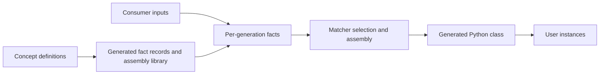

# Definitions, facts and generated instances

There are three distinct models:

The **concept** describes a generator. A **property** declares a semantic value,
type, default and storage spelling. A **record** groups properties; a **collection**
holds concrete records, optionally by identity. A family/union allows concrete
variants. These are generator input shapes, not the fields of a generated user
instance.

A **resource** is a generated value, often an Astichi source template. A **matcher**
selects a value from records. A **contribution** adds placement, bindings and build
identity to a resource or nested production. A composable **production** groups
roots and assembly steps. An **assembly** names a callable build entrypoint.
Data productions and operations instead produce facts before freezing.

In the tutorial, `FieldName` is a property, `FieldRow` is an emitted fact class,
`Fields` is a collection, `Param` is a contribution, and `Point` is the final user
class. `FieldRow(field_name="x", ...)` describes an input to generation; it is not
`Point.x`'s value. `Point(3, 4)` supplies the values after generation.

DDS is schema-only until a builder is created. Use a fresh builder for each
independent generation. Freeze facts before read-only assembly. Querying a frozen
view must not derive or mutate facts. Consumers own normalization policies such
as which fields participate in constructors or how dependency cycles are rejected.
